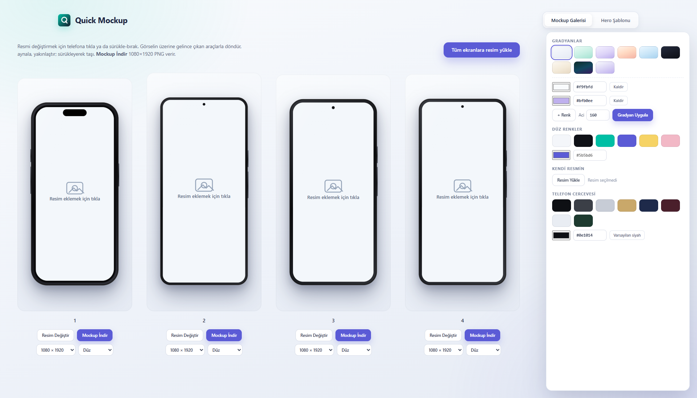

# Quick Mockup

Tarayıcıda çalışan, kurulum gerektirmeyen mockup stüdyosu. Ekran görüntünü 4 farklı telefon çerçevesine yerleştir; arka planı, yazıları ve çerçeve rengini özelleştir; PNG olarak indir.

## Özellikler

- 4 numaralı telefon çerçevesi (galeri) + hero şablonu
- Sağdaki sabit ayar paneli ekrana göre değişir: galeride arka plan + çerçeve, hero'da ek olarak yazı renkleri ve yazı stili
- Resim yükleme: telefona tıkla, sürükle-bırak veya "Tüm ekranlara resim yükle"
- Görsel düzenleme: döndür, yatay/dikey aynala, yakınlaştır/uzaklaştır, sürükleyerek taşı, sıfırla
- Arka plan: hazır gradyanlar (açı tümüne uygulanır), düz renkler, kendi çok renkli gradyanın (2–5 renk, açı), hex kodu, kendi arka plan resmin
- Hero arka plan resmi: taşıma, döndürme, aynalama, yakınlaştırma
- Yazı: 7 hazır font + kendi fontunu yükle (TTF/OTF/WOFF/WOFF2), 6 efekt (gölge, sert gölge, 3D, neon, kontur), boyut ve renk ayarı; metinler tıkla-düzenle
- Telefon çerçevesi rengi (hazır renkler + hex); iç çerçeve otomatik uyum sağlar
- İndirme boyutu: 720p–4K arası (galeri 9:16, hero 16:10)
- İndirme stili: Düz, Stüdyo 3D, Eğim, Yansıma, Neon, Dergi; stil canlı önizlenir; her telefon için boyut/stil bağımsız
- PNG indirme: galeri 720×1280–2160×3840, hero 1280×800–3840×2400
- Mobil uyumlu: tek sütun düzen, panel içerik altında, dokunmatik taşıma ve büyük butonlar

## Font lisansı

8-bit font olarak gömülü **Press Start 2P** (Google Fonts, SIL Open Font License) kullanılır. Lisans metni: [`fonts/OFL.txt`](fonts/OFL.txt).

## Kullanım

1. `index.html` dosyasını tarayıcıda aç (çift tıkla).
2. Telefona tıkla ya da resmi sürükle-bırak.
3. **Arka Plan** panelinden özelleştir.
4. **Mockup İndir** / **PNG İndir** ile kaydet.

Kurulum, bağımlılık veya ağ bağlantısı gerekmez. Tüm işlemler tarayıcıda çalışır; hiçbir veri dışarı gönderilmez.
